# ajolotito

A new Flutter project.

## Getting Started

This project is a starting point for a Flutter application.

A few resources to get you started if this is your first Flutter project:

- [Learn Flutter](https://docs.flutter.dev/get-started/learn-flutter)
- [Write your first Flutter app](https://docs.flutter.dev/get-started/codelab)
- [Flutter learning resources](https://docs.flutter.dev/reference/learning-resources)

For help getting started with Flutter development, view the
[online documentation](https://docs.flutter.dev/), which offers tutorials,
samples, guidance on mobile development, and a full API reference.

## Ronda 1. Preparar el proyecto
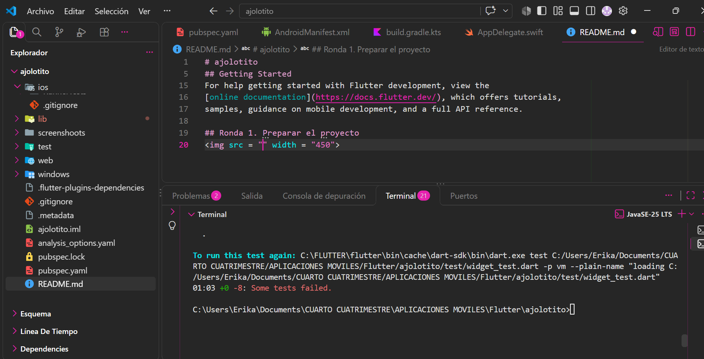

## Ronda 2. El reloj y el ajolot
### ROJO
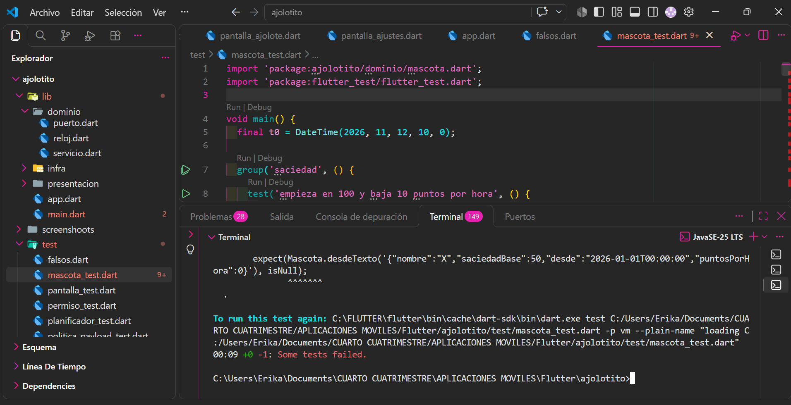

### VERDE
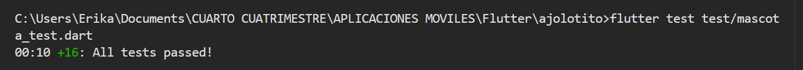

## Ronda 3. Categorías, canales y mensajes con personalidad
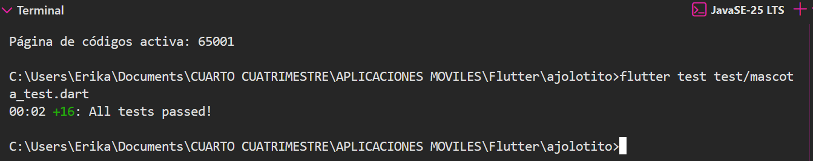

## Ronda 4. La política de buena educación
### ROJO
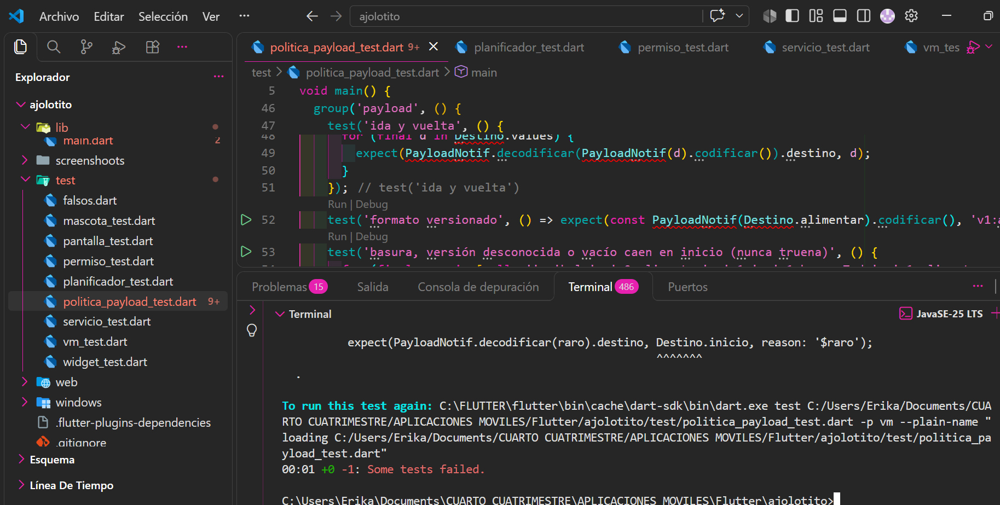

## Ronda 5. El payload: lo que viaja dentro
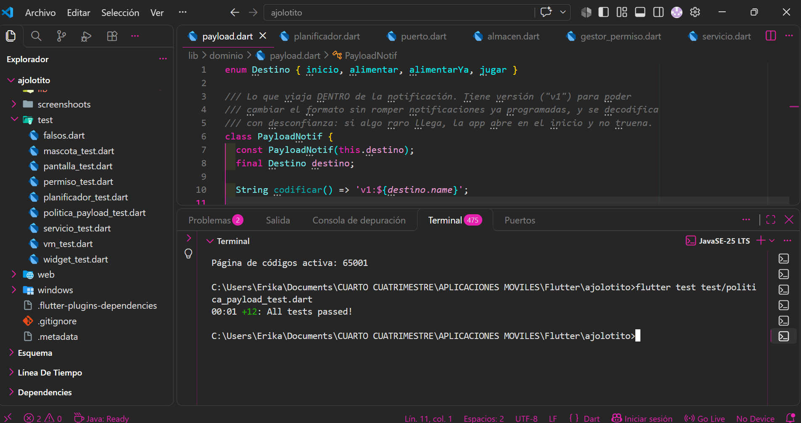

## Ronda 6. El planificador: del estado a la agenda de avisos
### ROJO
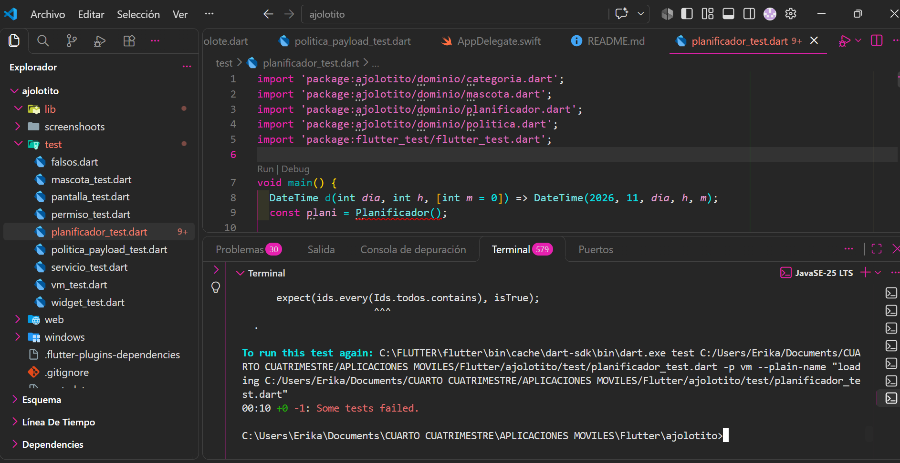

### VERDE
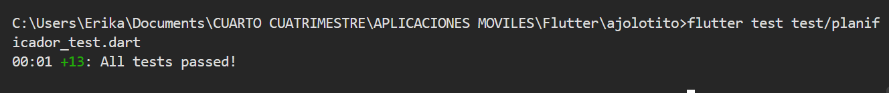

## Ronda 7. El puerto: aislar el plugin para poder probar
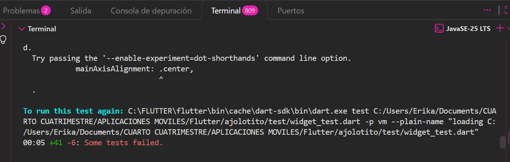

## Ronda 8. El permiso: pedir con inteligencia
### ROJO
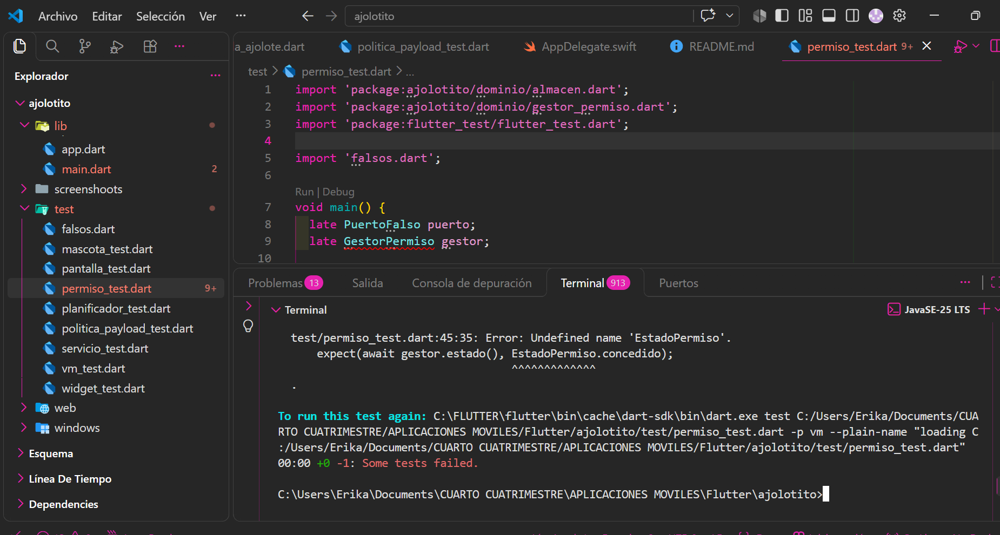

### VERDE
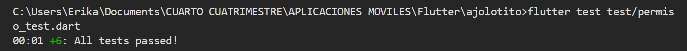

## Ronda 9. El servicio: mantener todo sincronizado
### ROJO
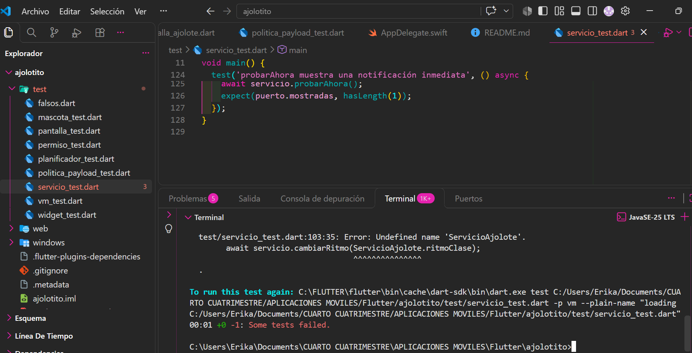

### VERDE
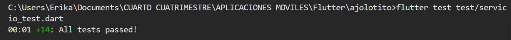

## Ronda 10. El adaptador real: hablar con el plugin
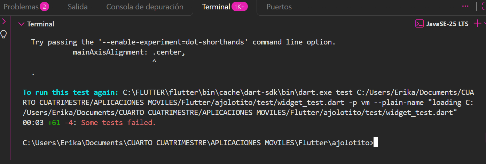

## Ronda 11. ViewModel, pantallas y arranque
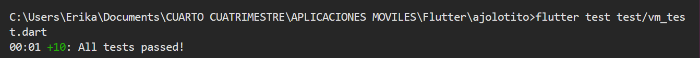
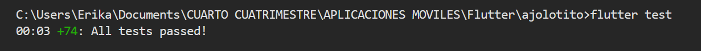

## Ronda 12. Probar en un teléfono de verdad
|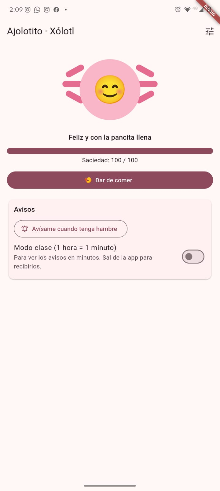|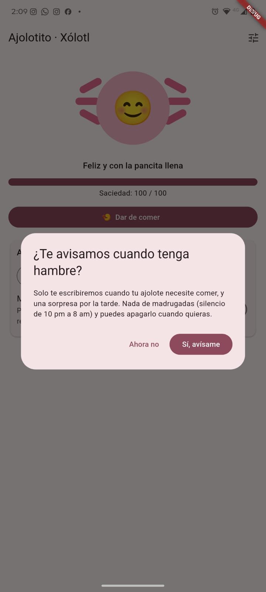|||

### Notificaciones
|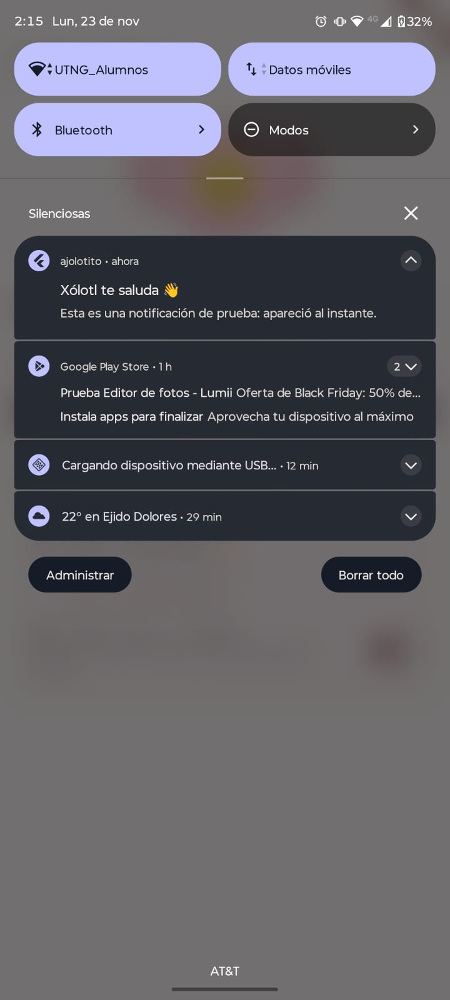|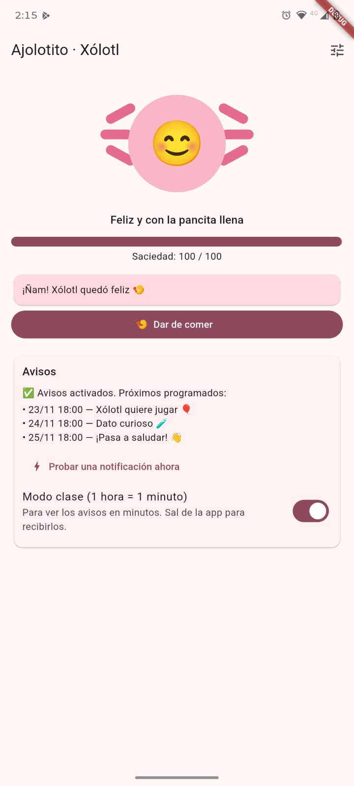| 